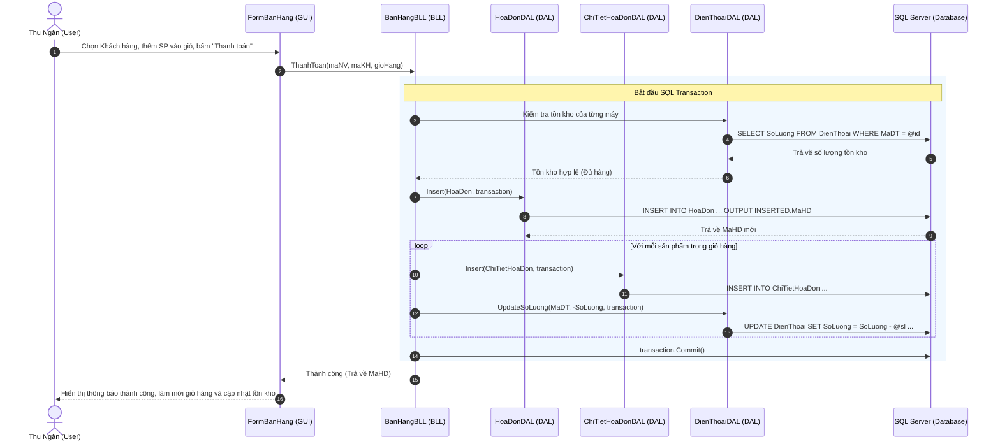
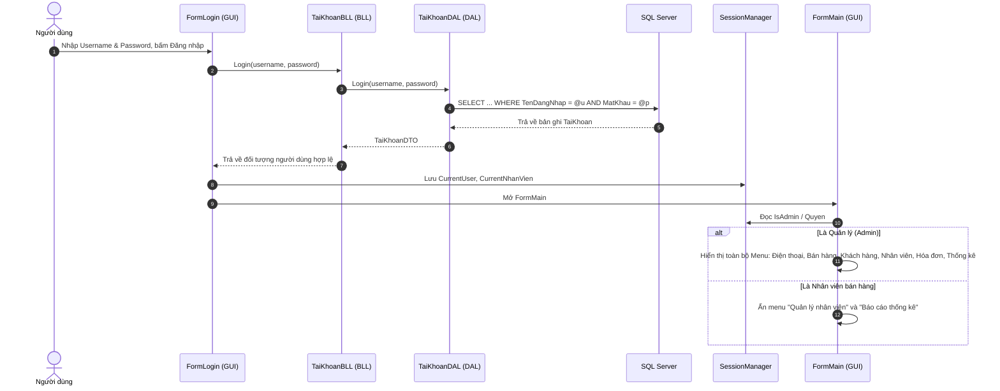

# TÀI LIỆU THIẾT KẾ KIẾN TRÚC HỆ THỐNG
# HỆ THỐNG QUẢN LÝ BÁN ĐIỆN THOẠI (PHONE SALE SYSTEM)

---

## 1. TỔNG QUAN KIẾN TRÚC (ARCHITECTURAL OVERVIEW)

Hệ thống Quản lý Bán Điện Thoại được xây dựng theo **Kiến trúc 3 lớp chuẩn hóa (3-Tier / N-Tier Architecture)** trên nền tảng **.NET 8** và **C#**. 

Mục tiêu của kiến trúc này là:
- **Tách biệt mối quan tâm (Separation of Concerns - SoC):** Giao diện (GUI), Nghiệp vụ (BLL), và Truy xuất dữ liệu (DAL) hoạt động độc lập, không phụ thuộc lẫn nhau một cách trực tiếp.
- **Dễ bảo trì và mở rộng:** Khi thay đổi giao diện (ví dụ chuyển sang WPF hoặc Web) hoặc thay đổi hệ quản trị CSDL, các tầng nghiệp vụ cốt lõi không bị ảnh hưởng.
- **Bảo mật và an toàn dữ liệu:** Chống SQL Injection qua Parameterized Queries và bảo toàn tính toàn vẹn giao dịch (ACID) qua SQL Transaction.

---

## 2. SƠ ĐỒ KIẾN TRÚC TỔNG THỂ (SYSTEM ARCHITECTURE DIAGRAM)

```mermaid
graph TD
    subgraph UI_Layer ["Tầng Giao Diện (Presentation Layer) - PhoneSaleSystem.GUI"]
        FormLogin["FormLogin\n(Đăng nhập)"]
        FormMain["FormMain\n(Dashboard & Điều hướng)"]
        FormBanHang["FormBanHang\n(Bán hàng & Giỏ hàng)"]
        FormDienThoai["FormDienThoai\n(Quản lý ĐT & Kho)"]
        FormKhachHang["FormKhachHang\n(Khách hàng)"]
        FormNhanVien["FormNhanVien\n(Nhân viên & Phân quyền)"]
        FormHoaDon["FormHoaDon\n(Lịch sử & Chi tiết)"]
        FormThongKe["FormThongKe\n(KPI & Doanh thu)"]
        SessionMgr["SessionManager\n(Phiên làm việc & Quyền)"]
        UITheme["UITheme\n(Bảng màu & Styling)"]
    end

    subgraph BLL_Layer ["Tầng Nghiệp Vụ (Business Logic Layer) - PhoneSaleSystem.BLL"]
        TaiKhoanBLL["TaiKhoanBLL"]
        BanHangBLL["BanHangBLL\n(Transaction Master)"]
        DienThoaiBLL["DienThoaiBLL"]
        KhachHangBLL["KhachHangBLL"]
        NhanVienBLL["NhanVienBLL"]
        HangBLL["HangBLL"]
        HoaDonBLL["HoaDonBLL"]
        ThongKeBLL["ThongKeBLL"]
    end

    subgraph DAL_Layer ["Tầng Truy Xuất Dữ Liệu (Data Access Layer) - PhoneSaleSystem.DAL"]
        DbHelper["DatabaseHelper\n(ADO.NET & Connection Pool)"]
        TaiKhoanDAL["TaiKhoanDAL"]
        DienThoaiDAL["DienThoaiDAL"]
        KhachHangDAL["KhachHangDAL"]
        NhanVienDAL["NhanVienDAL"]
        HangDAL["HangDAL"]
        HoaDonDAL["HoaDonDAL"]
        ChiTietHoaDonDAL["ChiTietHoaDonDAL"]
        ThongKeDAL["ThongKeDAL"]
    end

    subgraph DTO_Layer ["Tầng Dữ Liệu Truyền Tải (DTO Layer) - PhoneSaleSystem.DTO"]
        TaiKhoanDTO["TaiKhoanDTO"]
        NhanVienDTO["NhanVienDTO"]
        KhachHangDTO["KhachHangDTO"]
        HangDTO["HangDTO"]
        DienThoaiDTO["DienThoaiDTO"]
        HoaDonDTO["HoaDonDTO"]
        ChiTietDTO["ChiTietHoaDonDTO"]
        ThongKeDTO["ThongKeDTO"]
    end

    subgraph DB_Layer ["Cơ Sở Dữ Liệu (Database Layer) - Microsoft SQL Server"]
        SQLServer[("PhoneSaleDB\n(7 Tables + Stored Procedures)")]
    end

    %% Luồng dữ liệu giữa các tầng
    UI_Layer -->|Gọi xử lý nghiệp vụ| BLL_Layer
    BLL_Layer -->|Yêu cầu dữ liệu| DAL_Layer
    DAL_Layer -->|ADO.NET SQL Client| DB_Layer
    
    %% Tầng DTO được dùng xuyên suốt
    DTO_Layer -.-> UI_Layer
    DTO_Layer -.-> BLL_Layer
    DTO_Layer -.-> DAL_Layer
```



---

## 3. CHI TIẾT TỪNG PHÂN TẦNG (LAYER BREAKDOWN)

### 3.1. Tầng Presentation (Giao diện người dùng - `PhoneSaleSystem.GUI`)
- **Công nghệ:** Windows Forms (.NET 8 Windows SDK).
- **Trách nhiệm:**
  - Nhận sự kiện tương tác từ người dùng (click chuột, nhập liệu, phím tắt).
  - Kiểm tra sơ bộ định dạng dữ liệu phía giao diện (Validation sơ cấp).
  - Gọi xuống tầng BLL tương ứng để thực hiện thao tác logic.
  - Hiển thị kết quả, báo lỗi qua MessageBox hoặc cập nhật giao diện `DataGridView`.
- **Thành phần chính:**
  - `FormLogin`: Màn hình đăng nhập, xác thực tài khoản và ghi nhớ phiên qua `SessionManager`.
  - `FormMain`: Giao diện Dashboard chính với Sidebar menu điều hướng, nhúng các Form con vào Content Panel (`TopLevel = false`, `Dock = Fill`).
  - `FormBanHang`: Module trung tâm của nhân viên thu ngân - hiển thị danh mục máy, chọn khách, giỏ hàng động, tính tiền thừa và in hóa đơn.
  - `FormDienThoai`: Quản lý thông tin điện thoại, giá nhập/giá bán, cấu hình RAM/ROM, lọc theo hãng và cảnh báo tồn kho.
  - `FormKhachHang`: Quản lý hồ sơ khách hàng và tra cứu số điện thoại.
  - `FormNhanVien`: Quản lý nhân viên (chỉ dành cho Admin).
  - `FormHoaDon`: Xem danh sách hóa đơn và chi tiết sản phẩm từng hóa đơn.
  - `FormThongKe`: Thống kê KPI doanh thu theo khoảng thời gian, top sản phẩm bán chạy, báo cáo tồn kho.
  - `SessionManager`: Quản lý thông tin người dùng đang đăng nhập (`CurrentUser`, `CurrentNhanVien`, `IsAdmin`).
  - `UITheme`: Chuẩn hóa màu sắc thiết kế hiện đại (Primary Navy `#1E3A8A`, Accent `#3B82F6`, Background `#F3F4F6`).

### 3.2. Tầng Business Logic (Nghiệp vụ - `PhoneSaleSystem.BLL`)
- **Công nghệ:** C# Class Library (.NET 8).
- **Trách nhiệm:**
  - Đóng gói toàn bộ quy tắc nghiệp vụ (Business Rules).
  - Xác thực tính hợp lệ của dữ liệu: Tên không để trống, giá không âm, số điện thoại đúng định dạng, số lượng mua không vượt tồn kho.
  - **Quản lý Transaction:** Trong nghiệp vụ bán hàng (`BanHangBLL.ThanhToan`), mở một `SqlTransaction` để thực hiện chuỗi hành động nguyên tử:
    1. Tạo hóa đơn mới.
    2. Lưu các dòng chi tiết hóa đơn.
    3. Trừ số lượng tồn kho của các sản phẩm tương ứng.
    4. Nếu có bất kỳ lỗi nào, tự động `Rollback()` để dữ liệu không bị sai lệch.
- **Thành phần chính:** `TaiKhoanBLL`, `DienThoaiBLL`, `KhachHangBLL`, `NhanVienBLL`, `HangBLL`, `BanHangBLL`, `HoaDonBLL`, `ThongKeBLL`.

### 3.3. Tầng Data Access (Truy xuất dữ liệu - `PhoneSaleSystem.DAL`)
- **Công nghệ:** ADO.NET với gói thư viện chính thức `Microsoft.Data.SqlClient`.
- **Trách nhiệm:**
  - Thực hiện kết nối tới SQL Server thông qua connection string.
  - Thực thi các câu lệnh truy vấn SQL (SELECT) và câu lệnh thay đổi dữ liệu (INSERT, UPDATE, DELETE).
  - Sử dụng đối tượng `SqlParameter` cho mọi biến đầu vào nhằm triệt tiêu hoàn toàn nguy cơ **SQL Injection**.
  - Đọc dữ liệu từ `DataTable` / `SqlDataReader` và ánh xạ (mapping) sang các đối tượng DTO.
- **Thành phần cốt lõi:**
  - `DatabaseHelper`: Cung cấp các phương thức dùng chung:
    - `ExecuteQuery(string query, SqlParameter[]? params)`: Trả về `DataTable`.
    - `ExecuteNonQuery(string query, SqlParameter[]? params, SqlTransaction? tran)`: Trả về số dòng bị ảnh hưởng.
    - `ExecuteScalar(string query, SqlParameter[]? params, SqlTransaction? tran)`: Trả về giá trị đơn lẻ (VD: ID tự sinh `SCOPE_IDENTITY()`).

### 3.4. Tầng Data Transfer Objects (`PhoneSaleSystem.DTO`)
- **Công nghệ:** C# POCO (Plain Old CLR Objects) độc lập, không phụ thuộc vào bất kỳ thư viện ngoài nào.
- **Trách nhiệm:** Đóng vai trò là vật chứa dữ liệu để luân chuyển giữa GUI, BLL và DAL.
- **Các thực thể:**
  - `TaiKhoanDTO`: Thông tin tài khoản đăng nhập và quyền truy cập (`Admin`, `NhanVien`).
  - `NhanVienDTO`: Họ tên, số điện thoại, địa chỉ, chức vụ, mã tài khoản.
  - `KhachHangDTO`: Họ tên, số điện thoại, địa chỉ khách mua.
  - `HangDTO`: Mã hãng, tên hãng sản xuất.
  - `DienThoaiDTO`: Cấu hình máy (RAM, BoNho, MauSac), giá nhập, giá bán, số lượng tồn kho.
  - `HoaDonDTO`: Mã hóa đơn, mã nhân viên, mã khách hàng, ngày lập, tổng tiền.
  - `ChiTietHoaDonDTO`: Mã hóa đơn, mã điện thoại, số lượng mua, đơn giá, thành tiền.
  - `ThongKeDTO` (`DoanhThuDTO`, `SanPhamBanChayDTO`, `TonKhoDTO`): Chứa dữ liệu tổng hợp cho báo cáo.

### 3.5. Tầng Cơ sở dữ liệu (`database/` - SQL Server)
- CSDL `PhoneSaleDB` gồm 7 bảng quan hệ:
  1. `TaiKhoan` (1) ── (1) `NhanVien`
  2. `Hang` (1) ── (N) `DienThoai`
  3. `NhanVien` (1) ── (N) `HoaDon`
  4. `KhachHang` (1) ── (N) `HoaDon`
  5. `HoaDon` (1) ── (N) `ChiTietHoaDon`
  6. `DienThoai` (1) ── (N) `ChiTietHoaDon`
- Các Stored Procedure hỗ trợ: `sp_ThongKeDoanhThu`, `sp_TopSanPhamBanChay`, `sp_BaoCaoTonKho`.

---

## 4. LUỒNG DỮ LIỆU ĐIỂN HÌNH (DATA FLOW)

### 4.1. Luồng Bán hàng và Thanh toán (Giao dịch ACID)



### 4.2. Luồng Đăng nhập & Phân quyền



---
## 5. BẢN ĐỒ CẤU TRÚC THƯ MỤC DỰ ÁN

```
PhoneSaleSystem/
│
├── PhoneSaleSystem.sln                     # Solution chuẩn cho Visual Studio 2022
├── PhoneSaleSystem.slnx                    # Modern XML Solution format (.NET 8/10)
├── README.md                               # Hướng dẫn khởi chạy, cấu hình và sử dụng
├── .gitignore                              # Cấu hình bỏ qua file rác biên dịch
│
├── database/                               # Toàn bộ script cơ sở dữ liệu SQL Server
│   ├── 01_CreateDatabase_Tables.sql        # Tạo CSDL PhoneSaleDB và 7 bảng chuẩn
│   ├── 02_StoredProcedures.sql             # Stored Procedures báo cáo & tồn kho
│   └── 03_SeedData.sql                     # Dữ liệu mẫu khởi tạo
│
├── document/                               # Thư mục lưu trữ toàn bộ tài liệu dự án
│   ├── ARCHITECTURE.md                     # [Tài liệu này] Bản vẽ và đặc tả kiến trúc hệ thống
│   ├── BAOCAO_HETHONGBANDIENTHOAI.md       # Báo cáo đồ án chi tiết đầy đủ 18 phần
│   ├── C#_BAOCAOLON_HETHONGBANDIENTHOAI.docx # Bản Word gốc
│   └── images/                             # Toàn bộ hình ảnh minh họa trong báo cáo
│       ├── image1.png                      # Logo Trường UTT
│       ├── image2.png                      # Sơ đồ quy trình bán hàng
│       └── image3.png                      # Sơ đồ mô hình đề xuất
│
└── sourceCode/                             # Toàn bộ mã nguồn phân tầng chuẩn
    ├── PhoneSaleSystem.DTO/                # Tầng Thực thể (Entities / DTOs)
    ├── PhoneSaleSystem.DAL/                # Tầng Truy xuất dữ liệu (ADO.NET)
    ├── PhoneSaleSystem.BLL/                # Tầng Xử lý nghiệp vụ & Transaction
    └── PhoneSaleSystem.GUI/                # Tầng Giao diện người dùng (WinForms)
```

---

## 6. NGUYÊN TẮC BẢO MẬT & CHUẨN THIẾT KẾ

1. **Phòng chống tấn công SQL Injection:**
   - 100% câu lệnh truy vấn có biến số trong `PhoneSaleSystem.DAL` đều sử dụng `SqlParameter` với kiểu dữ liệu rõ ràng (`SqlDbType.Int`, `SqlDbType.NVarChar`, v.v.). Tuyệt đối không dùng kỹ thuật cộng chuỗi (`query + input`).
2. **Quản lý bộ nhớ & Kết nối an toàn (Resource Management):**
   - Mọi đối tượng kết nối `SqlConnection`, `SqlCommand`, `SqlDataAdapter`, `SqlDataReader` đều được bọc trong cú pháp `using` hoặc `using var` để đảm bảo kết nối luôn được đóng và giải phóng (Dispose) ngay cả khi phát sinh ngoại lệ.
3. **Kiểm soát phân quyền chặt chẽ:**
   - Nhân viên bán hàng chỉ được thao tác trên các tính năng được chỉ định (bán hàng, xem điện thoại, quản lý khách hàng). Các chức năng quản trị nhạy cảm (nhân viên, cấp quyền, báo cáo tài chính/doanh thu) được bảo vệ cả ở tầng giao diện lẫn tầng nghiệp vụ.
