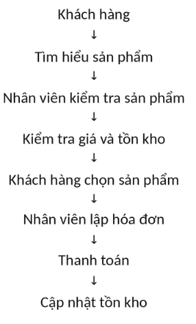
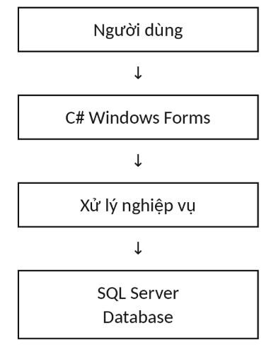

<div align="center">

### TRƯỜNG ĐẠI HỌC CÔNG NGHỆ GTVT
### KHOA CÔNG NGHỆ THÔNG TIN


# BÁO CÁO MÔN HỌC
## ĐỀ TÀI NGHIÊN CỨU:
# HỆ THỐNG BÁN ĐIỆN THOẠI

**Giảng viên hướng dẫn:** 
**Lớp học phần:** 75DCTT26  
**Nhóm sinh viên thực hiện:** Nhóm 20  

**Thành viên tham gia:**
- **Lại Văn Lưỡng** - MSV: 75DCTT21424
- **Nguyễn Vũ Duy** - MSV: 75DCTT21275
- **Nguyễn Khắc Trọng** - MSV: 75DCTT...
- **Nguyễn Đức Tuấn** - MSV: 75DCTT21576
- **Nguyễn Tùng Dương** - MSV: 74DCTT21376

**HÀ NỘI – 2026**

</div>

---

# PHẦN I. MỞ ĐẦU

### 1. Lý do chọn đề tài

Hiện nay, điện thoại thông minh là một trong những thiết bị điện tử được sử dụng phổ biến. Các cửa hàng kinh doanh điện thoại phải quản lý nhiều loại sản phẩm khác nhau, nhiều hãng sản xuất, nhiều mức giá và số lượng tồn kho. Bên cạnh đó, cửa hàng còn phải quản lý thông tin khách hàng, nhân viên, hóa đơn và doanh thu.

Nếu thực hiện quản lý bằng sổ sách hoặc các file Excel riêng lẻ, cửa hàng có thể gặp nhiều vấn đề như:

- Khó kiểm soát số lượng điện thoại tồn kho.
- Mất nhiều thời gian khi tìm kiếm sản phẩm.
- Dễ xảy ra sai sót khi nhập hoặc bán hàng.
- Khó quản lý thông tin khách hàng.
- Khó theo dõi lịch sử mua hàng.
- Khó thống kê doanh thu.
- Việc lập hóa đơn thủ công mất thời gian.
- Dữ liệu có thể bị trùng lặp hoặc thất lạc.
Vì vậy, nhóm lựa chọn đề tài “Xây dựng hệ thống quản lý và bán điện thoại” nhằm xây dựng một phần mềm hỗ trợ cửa hàng quản lý các hoạt động kinh doanh một cách tập trung, chính xác và hiệu quả.

# PHẦN II. TỔNG QUAN ĐỀ TÀI

### 2.1. Tên đề tài

Xây dựng hệ thống quản lý và bán điện thoại

### 2.2. Đối tượng sử dụng

Hệ thống hướng tới các đối tượng:

- Quản trị viên.
- Nhân viên bán hàng.
- Nhân viên quản lý.
- Người quản lý cửa hàng.

### 2.3. Phạm vi đề tài

Hệ thống tập trung vào các chức năng:

1. Đăng nhập.
2. Phân quyền người dùng.
3. Quản lý điện thoại.
4. Quản lý hãng điện thoại.
5. Quản lý khách hàng.
6. Quản lý nhân viên.
7. Bán hàng.
8. Quản lý giỏ hàng.
9. Lập hóa đơn.
10. Quản lý chi tiết hóa đơn.
11. Quản lý tồn kho.
12. Tìm kiếm sản phẩm.
13. Thống kê doanh thu.
14. Thống kê sản phẩm bán chạy.

# PHẦN III. KHẢO SÁT HỆ THỐNG HIỆN TẠI

### 3.1. Quy trình hoạt động của cửa hàng

Quy trình bán hàng hiện tại có thể được mô tả:



### 3.2. Quản lý sản phẩm

Nhân viên quản lý thông tin:

- Mã điện thoại.
- Tên điện thoại.
- Hãng.
- RAM.
- Bộ nhớ.
- Màu sắc.
- Giá nhập.
- Giá bán.
- Số lượng.
- Thời gian bảo hành.

### 3.3. Quản lý khách hàng

Thông tin khách hàng gồm:

- Mã khách hàng.
- Họ tên.
- Số điện thoại.
- Địa chỉ.

### 3.4. Quản lý nhânviên

Thông tin nhân viên:

- Mã nhân viên.
- Họ tên.
- Số điện thoại.
- Địa chỉ.
- Chức vụ.

### 3.5. Những hạn chế của hệ thống hiện tại

Một số hạn chế:

- Quản lý thủ công.
- Tìm kiếm thông tin chậm.
- Dễ sai dữ liệu.
- Khó kiểm soát tồn kho.
- Không có hệ thống thống kê tự động.
- Khó theo dõi doanh thu.
- Khó quản lý lịch sử mua hàng.
- Khó phân quyền người sử dụng.

# PHẦN IV. ĐỀ XUẤT HỆ THỐNG MỚI

### 4.1. Mục tiêu của hệ thống

Hệ thống mới được xây dựng nhằm:

- Tin học hóa hoạt động quản lý cửa hàng.
- Quản lý tập trung dữ liệu.
- Giảm thời gian nhập liệu.
- Hạn chế sai sót.
- Hỗ trợ nhân viên bán hàng.
- Tự động tính tiền.
- Tự động cập nhật tồn kho.
- Quản lý hóa đơn.
- Thống kê doanh thu.
- Hỗ trợ người quản lý đưa ra quyết định.

### 4.2. Giải pháp đề xuất

Xây dựng phần mềm quản lý bán điện thoại trên nền tảng:

C# + Windows Forms + SQL Server

Mô hình:

- 
# PHẦN V. PHÂN TÍCH YÊU CẦU HỆ THỐNG

### 5.1. Yêu cầu chức năng

#### 5.1.1. Đăng nhập

Người dùng nhập:

```
Tên đăng nhập
Mật khẩu
```

Hệ thống kiểm tra thông tin.

Nếu đúng:

```
Đăng nhập thành công
↓
Hiển thị màn hình chính
```

Nếu sai:

```
Tên đăng nhập hoặc mật khẩu không chính xác
```

### 5.2. Quản lý điện thoại

Cho phép:

- Thêm điện thoại.
- Sửa điện thoại.
- Xóa điện thoại.
- Tìm kiếm.
- Lọc theo hãng.
- Xem thông tin.
- Cập nhật số lượng.
- Kiểm tra tồn kho.

### 5.3. Quản lý khách hàng

Cho phép:

- Thêm khách hàng.
- Sửa thông tin.
- Xóa khách hàng.
- Tìm kiếm khách hàng.
- Xem lịch sử mua hàng.

### 5.4. Quản lý nhân viên

Cho phép:

- Thêm nhân viên.
- Sửa.
- Xóa.
- Tìm kiếm.
- Phân quyền.

### 5.5. Chức năng bán hàng

Quy trình:

```
Chọn khách hàng
↓
Tìm điện thoại
↓
Chọn sản phẩm
↓
Nhập số lượng
↓
Thêm vào giỏ hàng
↓
Tính tiền
↓
Thanh toán
↓
Lập hóa đơn
↓
Trừ tồn kho
```

# PHẦN VI. PHÂN TÍCH USE CASE

### 6.1. Các Actor

Hệ thống có thể xác định các Actor:

#### Admin

Có quyền:

- Quản lý tài khoản.
- Quản lý nhân viên.
- Quản lý điện thoại.
- Quản lý khách hàng.
- Xem hóa đơn.
- Xem thống kê.

#### Nhân viên

Có quyền:

- Đăng nhập.
- Tìm kiếm sản phẩm.
- Quản lý khách hàng.
- Bán hàng.
- Lập hóa đơn.
- Xem thông tin sản phẩm.

## 6.2. Danh sách Use Case

| **STT** | **Use Case** | **Actor** |
| --- | --- | --- |
| 1 | Đăng nhập | Admin, Nhân viên |
| 2 | Quản lý điện thoại | Admin |
| 3 | Tìm kiếm điện thoại | Admin, Nhân viên |
| 4 | Quản lý khách hàng | Admin, Nhân viên |
| 5 | Quản lý nhân viên | Admin |
| 6 | Bán hàng | Nhân viên |
| 7 | Lập hóa đơn | Nhân viên |
| 8 | Quản lý hóa đơn | Admin |
| 9 | Quản lý tồn kho | Admin |
| 10 | Thống kê doanh thu | Admin |
| 11 | Thống kê sản phẩm | Admin |

# PHẦN VII. ĐẶC TẢ USE CASE

## UC01 – ĐĂNG NHẬP

**Actor:** Admin, Nhân viên

**Mục đích:** Cho phép người dùng đăng nhập vào hệ thống bằng tài khoản và mật khẩu.

**Tiền điều kiện:**

- Người dùng đã có tài khoản.
- Hệ thống đang hoạt động.
**Luồng chính:**

1. Người dùng mở phần mềm.
2. Hệ thống hiển thị màn hình đăng nhập.
3. Người dùng nhập tên đăng nhập.
4. Người dùng nhập mật khẩu.
5. Người dùng nhấn nút Đăng nhập.
6. Hệ thống kiểm tra thông tin.
7. Hệ thống xác định quyền của người dùng.
8. Hệ thống hiển thị giao diện tương ứng.
**Luồng ngoại lệ:**

- Tài khoản không tồn tại → thông báo tài khoản không tồn tại.
- Mật khẩu sai → thông báo mật khẩu không chính xác.
- Bỏ trống tài khoản/mật khẩu → yêu cầu nhập đầy đủ.
**Kết quả:** Người dùng đăng nhập thành công và được chuyển đến màn hình chính.

## UC02 – QUẢN LÝ ĐIỆN THOẠI

**Actor:** Admin

**Mục đích:** Cho phép Admin quản lý thông tin các điện thoại trong cửa hàng.

**Tiền điều kiện:**

- Admin đã đăng nhập.
- Admin có quyền quản lý điện thoại.
**Luồng chính:**

1. Admin chọn Quản lý điện thoại.
2. Hệ thống hiển thị danh sách điện thoại.
3. Admin chọn thao tác:
  - Thêm.
  - Sửa.
  - Xóa.
  - Tìm kiếm.
1. Hệ thống xử lý yêu cầu.
2. Hệ thống cập nhật dữ liệu.
3. Hệ thống hiển thị kết quả.
**Luồng ngoại lệ:**

- Mã điện thoại đã tồn tại.
- Không tìm thấy điện thoại.
- Dữ liệu nhập không hợp lệ.
- Không thể xóa sản phẩm đang được sử dụng trong hóa đơn.

## UC03 – QUẢN LÝ KHÁCH HÀNG

**Actor:** Admin, Nhân viên

**Mục đích:** Quản lý thông tin khách hàng của cửa hàng.

**Luồng chính:**

1. Người dùng chọn Quản lý khách hàng.
2. Hệ thống hiển thị danh sách khách hàng.
3. Người dùng nhập thông tin khách hàng.
4. Người dùng chọn Thêm/Sửa/Xóa/Tìm kiếm.
5. Hệ thống kiểm tra dữ liệu.
6. Hệ thống cập nhật cơ sở dữ liệu.
7. Hệ thống hiển thị kết quả.
Thông tin khách hàng:

```
Mã KH
Họ tên
Số điện thoại
Địa chỉ
```

## UC04 – QUẢN LÝ NHÂN VIÊN

**Actor:** Admin

**Mục đích:** Cho phép Admin quản lý thông tin nhân viên.

**Luồng chính:**

1. Admin chọn Quản lý nhân viên.
2. Hệ thống hiển thị danh sách.
3. Admin chọn Thêm/Sửa/Xóa/Tìm kiếm.
4. Nhập hoặc chỉnh sửa thông tin.
5. Hệ thống kiểm tra dữ liệu.
6. Hệ thống lưu thay đổi.
Thông tin:

```
Mã NV
Họ tên
Số điện thoại
Địa chỉ
Chức vụ
```

## UC05 – BÁN HÀNG

Đây là Use Case rất nên làm kỹ, vì nó là nghiệp vụ trung tâm của hệ thống.

**Actor:** Nhân viên

**Mục đích:** Cho phép nhân viên thực hiện giao dịch bán điện thoại cho khách hàng.

**Tiền điều kiện:**

- Nhân viên đã đăng nhập.
- Điện thoại có trong hệ thống.
- Sản phẩm còn hàng.
**Luồng chính:**

```
1. Nhân viên chọn Bán hàng.
2. Hệ thống hiển thị màn hình bán hàng.
3. Nhân viên tìm khách hàng.
4. Nhân viên tìm điện thoại.
5. Chọn sản phẩm.
6. Nhập số lượng.
7. Hệ thống kiểm tra tồn kho.
8. Hệ thống thêm sản phẩm vào giỏ hàng.
9. Hệ thống tính thành tiền.
10. Hệ thống tính tổng tiền.
11. Nhân viên xác nhận thanh toán.
12. Hệ thống tạo hóa đơn.
13. Hệ thống cập nhật tồn kho.
14. Hệ thống thông báo bán hàng thành công.
```

**Luồng ngoại lệ:**

- Sản phẩm không tồn tại.
- Sản phẩm hết hàng.
- Số lượng mua lớn hơn số lượng tồn.
- Khách hàng không tồn tại.
- Dữ liệu không hợp lệ.

## UC06 – LẬP HÓA ĐƠN

**Actor:** Nhân viên

**Mục đích:** Tạo hóa đơn sau khi khách hàng hoàn tất mua hàng.

**Luồng chính:**

1. Nhân viên xác nhận giao dịch.
2. Hệ thống lấy thông tin khách hàng.
3. Hệ thống lấy thông tin nhân viên.
4. Hệ thống lấy danh sách sản phẩm.
5. Hệ thống tính tổng tiền.
6. Hệ thống tạo mã hóa đơn.
7. Hệ thống lưu hóa đơn.
8. Hệ thống lưu chi tiết hóa đơn.
9. Hệ thống hiển thị hóa đơn.
Cấu trúc:

```
Hóa đơn
│
├── Mã hóa đơn
├── Ngày lập
├── Khách hàng
├── Nhân viên
├── Tổng tiền
│
└── Chi tiết
├── Điện thoại
├── Số lượng
├── Đơn giá
└── Thành tiền
```

## UC07 – QUẢN LÝ HÓA ĐƠN

**Actor:** Admin

**Mục đích:** Cho phép Admin xem và quản lý các hóa đơn đã phát sinh.

**Luồng chính:**

1. Admin chọn Quản lý hóa đơn.
2. Hệ thống hiển thị danh sách hóa đơn.
3. Admin tìm kiếm hoặc lọc hóa đơn.
4. Admin chọn một hóa đơn.
5. Hệ thống hiển thị chi tiết.
6. Admin có thể xem/in hóa đơn.
Có thể tìm theo:

```
Mã hóa đơn
Ngày lập
Khách hàng
Nhân viên
```

## UC08 – THỐNG KÊ DOANH THU

**Actor:** Admin

**Mục đích:** Giúp người quản lý theo dõi tình hình kinh doanh.

**Luồng chính:**

1. Admin chọn Thống kê.
2. Hệ thống hiển thị chức năng thống kê.
3. Admin chọn khoảng thời gian.
4. Hệ thống truy vấn dữ liệu hóa đơn.
5. Hệ thống tính tổng doanh thu.
6. Hệ thống hiển thị kết quả.
Có thể thống kê:

```
Doanh thu ngày
Doanh thu tháng
Doanh thu năm
Số lượng hóa đơn
Số điện thoại đã bán
Sản phẩm bán chạy
```

# PHẦN VIII. THIẾT KẾ CƠ SỞ DỮ LIỆU

Đây là phần rất quan trọng của dự án.

Có thể thiết kế các bảng:

### 8.1. Bảng TaiKhoan

| **Cột** | **Kiểu dữ liệu** |
| --- | --- |
| MaTK | INT |
| TenDangNhap | VARCHAR |
| MatKhau | VARCHAR |
| Quyen | VARCHAR |

### 8.2. Bảng NhanVien

| **Cột** | **Kiểu dữ liệu** |
| --- | --- |
| MaNV | INT |
| HoTen | NVARCHAR |
| SDT | VARCHAR |
| DiaChi | NVARCHAR |
| ChucVu | NVARCHAR |

### 8.3. Bảng KhachHang

| **Cột** | **Kiểu dữ liệu** |
| --- | --- |
| MaKH | INT |
| HoTen | NVARCHAR |
| SDT | VARCHAR |
| DiaChi | NVARCHAR |

### 8.4. Bảng Hang

| **Cột** | **Kiểu dữ liệu** |
| --- | --- |
| MaHang | INT |
| TenHang | NVARCHAR |

Ví dụ:

```
Apple
Samsung
Xiaomi
OPPO
Vivo
```

### 8.5. Bảng DienThoai

| **Cột** | **Kiểu dữ liệu** |
| --- | --- |
| MaDT | INT |
| TenDT | NVARCHAR |
| MaHang | INT |
| RAM | VARCHAR |
| BoNho | VARCHAR |
| MauSac | NVARCHAR |
| GiaNhap | DECIMAL |
| GiaBan | DECIMAL |
| SoLuong | INT |
| BaoHanh | INT |

### 8.6. Bảng HoaDon

| **Cột** | **Kiểu dữ liệu** |
| --- | --- |
| MaHD | INT |
| MaNV | INT |
| MaKH | INT |
| NgayLap | DATETIME |
| TongTien | DECIMAL |

### 8.7. Bảng ChiTietHoaDon

| **Cột** | **Kiểu dữ liệu** |
| --- | --- |
| MaHD | INT |
| MaDT | INT |
| SoLuong | INT |
| DonGia | DECIMAL |
| ThanhTien | DECIMAL |

# PHẦN IX. QUAN HỆ GIỮA CÁC BẢNG

Có thể mô hình hóa:

```
HANG
│
│ 1 - N
↓
DIENTHOAI
│
│ 1 - N
↓
CHITIETHOADON
│
│ N - 1
↓
HOADON
↙       ↘
KHACHHANG  NHANVIEN
```

Đối với tài khoản:

```
NHANVIEN
│
│
↓
TAIKHOAN
```

# PHẦN X. THIẾT KẾ GIAO DIỆN

### 10.1. Form đăng nhập

```
┌─────────────────────────────┐
│       ĐĂNG NHẬP             │
│                             │
│ Tài khoản: [____________]   │
│ Mật khẩu:  [____________]   │
│                             │
│       [ ĐĂNG NHẬP ]         │
└─────────────────────────────┘
```

### 10.2. Form chính

```
┌─────────────────────────────────────────┐
│        HỆ THỐNG QUẢN LÝ BÁN ĐIỆN THOẠI│
├─────────────────────────────────────────┤
│ Điện thoại | Khách hàng | Nhân viên    │
│ Bán hàng   | Hóa đơn     | Thống kê     │
│                                         │
│              Nội dung                   │
│                                         │
└─────────────────────────────────────────┘
```

### 10.3. Form quản lý điện thoại

Các TextBox:

- Mã điện thoại.
- Tên điện thoại.
- Hãng.
- RAM.
- Bộ nhớ.
- Màu sắc.
- Giá nhập.
- Giá bán.
- Số lượng.
Các Button:

```
[Thêm] [Sửa] [Xóa] [Làm mới] [Tìm kiếm]
```

# PHẦN XI. THIẾT KẾ CHỨC NĂNG BÁN HÀNG

Đây là module quan trọng nhất.

Giao diện:

```
┌────────────────────────────────────────────┐
│                 BÁN HÀNG                  │
├────────────────────────────────────────────┤
│ Khách hàng: [_____________]                │
│                                            │
│ Tìm sản phẩm: [_____________] [Tìm]        │
│                                            │
│ ┌────────────────────────────────────────┐ │
│ │ Mã │ Tên │ Đơn giá │ SL │ Thành tiền │ │
│ ├────────────────────────────────────────┤ │
│ │    │     │         │    │            │ │
│ └────────────────────────────────────────┘ │
│                                            │
│ Tổng tiền: ........................        │
│                                            │
│          [THANH TOÁN]                     │
└────────────────────────────────────────────
```

# PHẦN XII. THỐNG KÊ – BÁO CÁO

Hệ thống có thể thống kê:

#### 12.1. Doanh thu

```
Doanh thu ngày
Doanh thu tháng
Doanh thu năm
```

#### 12.2. Sản phẩm bán chạy

Ví dụ:

| **Điện thoại** | **Số lượng bán** |
| --- | --- |
| iPhone 15 | 25 |
| Samsung S24 | 18 |
| Xiaomi 14 | 15 |

#### 12.3. Tồn kho

| **Điện thoại** | **Tồn kho** |
| --- | --- |
| iPhone 15 | 8 |
| Samsung S24 | 12 |
| Xiaomi 14 | 5 |

Có thể bổ sung biểu đồ cột hoặc biểu đồ tròn để báo cáo trực quan hơn.

# PHẦN XIII. PHÂN QUYỀN

### Admin

```
Đăng nhập
↓
Quản lý toàn bộ hệ thống
├── Điện thoại
├── Khách hàng
├── Nhân viên
├── Hóa đơn
├── Tài khoản
└── Thống kê
```

### Nhân viên

```
Đăng nhập
↓
├── Xem điện thoại
├── Tìm kiếm
├── Khách hàng
├── Bán hàng
└── Lập hóa đơn
```

# PHẦN XIV. CÔNG NGHỆ SỬ DỤNG

### 14.1. Ngôn ngữ

C#

### 14.2. Giao diện

Windows Forms

### 14.3. Cơ sở dữ liệu

Microsoft SQL Server

### 14.4. Môi trường phát triển

Visual Studio

### 14.5. Kết nối dữ liệu

Có thể sử dụng:

```
ADO.NET
```

để kết nối C# với SQL Server.

# PHẦN XV. KIỂM THỬ HỆ THỐNG

Có thể lập bảng:

| **STT** | **Chức năng** | **Dữ liệu kiểm thử** | **Kết quả mong muốn** |
| --- | --- | --- | --- |
| 1 | Đăng nhập | Đúng TK/MK | Đăng nhập thành công |
| 2 | Đăng nhập | Sai mật khẩu | Thông báo lỗi |
| 3 | Thêm điện thoại | Dữ liệu hợp lệ | Thêm thành công |
| 4 | Sửa điện thoại | Dữ liệu mới | Cập nhật thành công |
| 5 | Xóa điện thoại | Mã tồn tại | Xóa thành công |
| 6 | Tìm kiếm | Tên sản phẩm | Hiển thị kết quả |
| 7 | Thêm khách hàng | Dữ liệu hợp lệ | Thêm thành công |
| 8 | Bán hàng | Số lượng hợp lệ | Tạo hóa đơn |
| 9 | Thanh toán | Đủ thông tin | Thanh toán thành công |
| 10 | Tồn kho | Sau khi bán | Số lượng giảm |
| 11 | Thống kê | Khoảng thời gian | Hiển thị doanh thu |

# PHẦN XVI. KẾT QUẢ ĐẠT ĐƯỢC

Sau khi hoàn thành, hệ thống có thể:

- Quản lý tập trung thông tin điện thoại.
- Quản lý khách hàng.
- Quản lý nhân viên.
- Quản lý tài khoản.
- Hỗ trợ bán hàng.
- Tự động tính tiền.
- Lập hóa đơn.
- Cập nhật tồn kho.
- Tìm kiếm dữ liệu.
- Thống kê doanh thu.
- Thống kê sản phẩm bán chạy.
- Phân quyền người sử dụng.

# PHẦN XVII. HẠN CHẾ VÀ HƯỚNG PHÁT TRIỂN

### 17.1. Hạn chế

Phiên bản hiện tại có thể còn hạn chế:

- Chưa hỗ trợ bán hàng trực tuyến.
- Chưa tích hợp thanh toán online.
- Chưa có ứng dụng mobile.
- Chưa kết nối với hệ thống vận chuyển.
- Chưa có chức năng gửi thông báo tự động.

### 17.2. Hướng phát triển

Trong tương lai có thể:

- Xây dựng website bán điện thoại.
- Xây dựng ứng dụng Android/iOS.
- Tích hợp thanh toán QR.
- Tích hợp ví điện tử.
- Quản lý bảo hành.
- Quản lý khuyến mãi.
- Quản lý nhập hàng từ nhà cung cấp.
- Xây dựng chương trình khách hàng thân thiết.
- Phân tích doanh thu bằng biểu đồ.
- Kết hợp AI để dự đoán nhu cầu sản phẩm.

# PHẦN XVIII. KẾT LUẬN

Đề tài “Xây dựng hệ thống quản lý và bán điện thoại” nhằm giải quyết những vấn đề trong việc quản lý hoạt động kinh doanh tại cửa hàng điện thoại. Hệ thống giúp tập trung dữ liệu về sản phẩm, khách hàng, nhân viên, hóa đơn và doanh thu trên một nền tảng thống nhất.

Thông qua việc xây dựng hệ thống, nhóm có cơ hội vận dụng các kiến thức về phân tích yêu cầu, thiết kế cơ sở dữ liệu, lập trình C#, xây dựng giao diện Windows Forms và kết nối SQL Server. Hệ thống không chỉ hỗ trợ các nghiệp vụ bán hàng mà còn cung cấp các chức năng thống kê, giúp người quản lý theo dõi tình hình kinh doanh hiệu quả hơn.

Trong tương lai, hệ thống có thể tiếp tục được mở rộng với các chức năng bán hàng trực tuyến, thanh toán điện tử, quản lý bảo hành, khuyến mãi và ứng dụng trên thiết bị di động.
